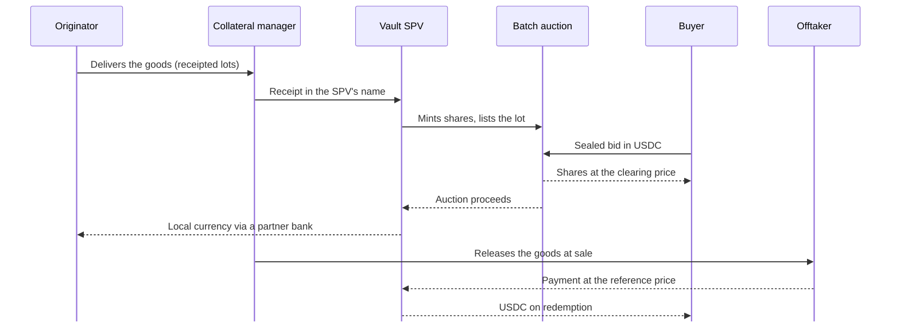

Cargo is a **venue for receipted real-world assets**. In each vault, the Vault SPV is the only seller of new shares. Originators supply receipted lots, buyers bid for shares below NAV, and market makers keep the secondary price close to NAV. Cargo earns venue fees on that flow, not a spread on your capital.

## Architecture

Every vault is built from the same layers. The examples in brackets are the Genesis Vault's.

| Layer | What it does |
| :-- | :-- |
| Goods | Receipted lots in a warehouse or vault under an independent collateral manager (Genesis Vault: lots of 25 t or more) |
| Title and security | Vault SPV owns every lot; one registered pledge over the goods, held by a security agent for all holders (a pledge with dispossession) |
| Token | One ERC-3643 token per vault, 1 share = 1 unit of the asset; transfers only between whitelisted identities (Genesis Vault: cvCOCOA, 1 share = 1 kg) |
| Primary market | Genesis curve, then a sealed batch auction at a fixed interval; the SPV is the only seller (Genesis Vault: every 12 days) |
| Anchor | Creation at NAV + 0.10%, redemption at NAV − 0.10%, Liquidity Bridge at NAV − 1.0%, physical delivery above a set size |
| Secondary | Bilateral: RFQ to panel market makers acting as principals; permissioned pools are planned |
| Data | Daily NAV and minute-by-minute iNAV; lot registry; weekly collateral-manager reports hashed on-chain |

## How money and goods flow

How goods and money move between the parties, step by step. Solid arrows are goods and actions; dashed arrows are payments. Buyers settle atomically in the auction, and the Vault SPV is paid when the goods are sold to an offtaker.

## Fee schedule

The venue fees below are the standard schedule, as set for the Genesis Vault. Each vault's Rulebook confirms its own schedule.

| Fee | Rate | Paid by | When |
| :-- | :-- | :-- | :-- |
| Genesis curve | None | — | — |
| Listing and servicing | 0.50% of NAV | Originator | Once per lot, at first sale |
| Batch auction | 0.25% each side | Buyer and seller | Each sale (panel market makers bid fee-free) |
| Creation or redemption | 0.10% | Authorised participant or redeeming holder | Each creation or redemption |
| Liquidity Bridge | 1.0% | Holder using the bridge | Paid to bridge LPs |
| Storage, collateral management, insurance | At cost | Originator | Until the goods are sold |
| Management or storage fee for holders | None | — | — |

In the Genesis Vault, over a lot's life of about 45 days, venue fees come to about **1.35% of the lot**: 0.50% listing, plus 0.25% on each side of about 1.5 auction trades (0.75%), plus 0.10% on redemption. That is an estimate, not a fixed charge; lot life differs by asset.

<Note>
  Rule and fee changes take effect after 30 days' notice, except safety fixes. The binding schedule is in the Rulebook and your signed agreement.
</Note>
