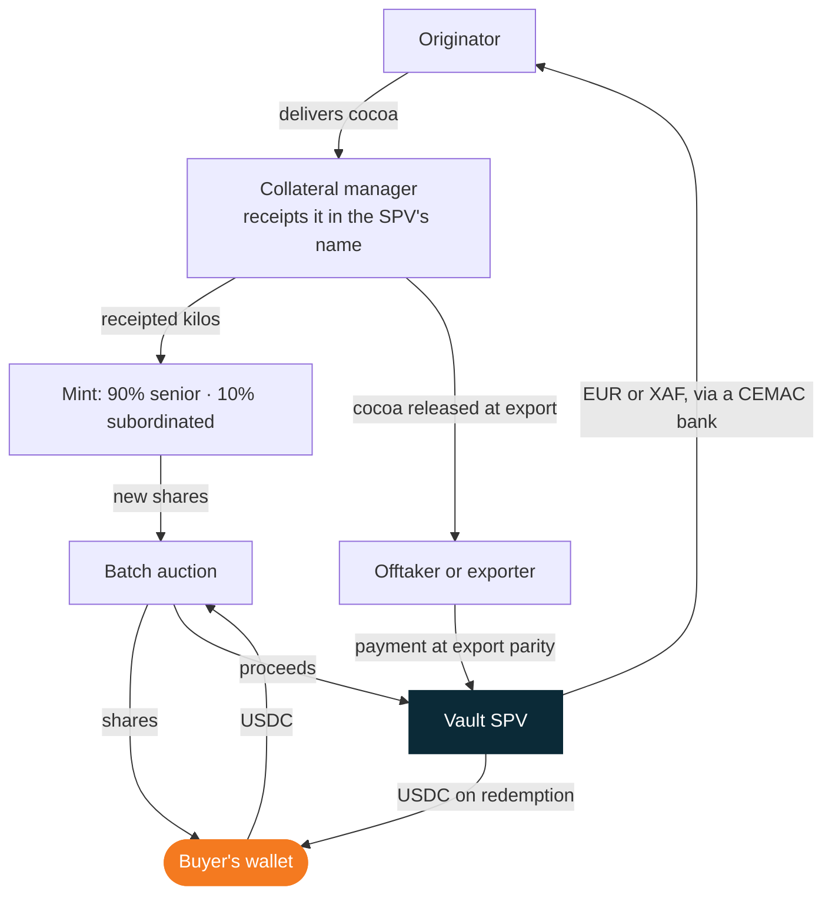

Cargo Vault One is a **venue for receipted commodities**. The Vault SPV is the only seller of new shares. Originators supply receipted lots, buyers bid for shares below NAV, and market makers keep the secondary price close to NAV. Cargo earns venue fees on that flow, not a spread on your capital.

## Architecture

| Layer | What it does |
| :-- | :-- |
| Goods | Receipted lots of 25 t or more in a collateral-managed bay at AGL Bonabéri, Douala |
| Title and security | Vault SPV owns every lot; one OHADA pledge with dispossession, registered at the RCCM, held by a security agent |
| Token | cvCOCOA, ERC-3643, 1 share = 1 kg; transfers only between whitelisted identities |
| Primary market | Genesis curve, then a sealed batch auction every 12 days; the SPV is the only seller |
| Anchor | Creation at NAV + 0.10%, redemption at NAV − 0.10%, Liquidity Bridge at NAV − 1.0%, physical delivery from 10 t |
| Secondary | Bilateral: RFQ to panel market makers acting as principals; a permissioned pool is planned |
| Data | Daily NAV and minute-by-minute iNAV; lot registry; weekly collateral-manager reports hashed on-chain |

## How money and goods flow

How cocoa and money move between the parties. Buyers settle atomically in the auction, and the Vault SPV is paid when the cocoa is exported.

## Fee schedule

| Fee | Rate | Paid by | When |
| :-- | :-- | :-- | :-- |
| Genesis curve | None | — | — |
| Listing and servicing | 0.50% of NAV | Originator | Once per lot, at first sale |
| Batch auction | 0.25% each side | Buyer and seller | Each sale (panel market makers bid fee-free) |
| Creation or redemption | 0.10% | Authorised participant or redeeming holder | Each creation or redemption |
| Liquidity Bridge | 1.0% | Holder using the bridge | Paid to bridge LPs |
| Storage, collateral management, insurance | At cost | Originator | Until export |
| Management or storage fee for holders | None | — | — |

Over a lot's life of about 45 days, venue fees come to about **1.35% of the lot**: 0.50% listing, plus 0.25% on each side of about 1.5 auction trades (0.75%), plus 0.10% on redemption. That is an estimate, not a fixed charge.

<Note>
  Rule and fee changes take effect after 30 days' notice, except safety fixes. The binding schedule is in the Rulebook and your signed agreement.
</Note>
