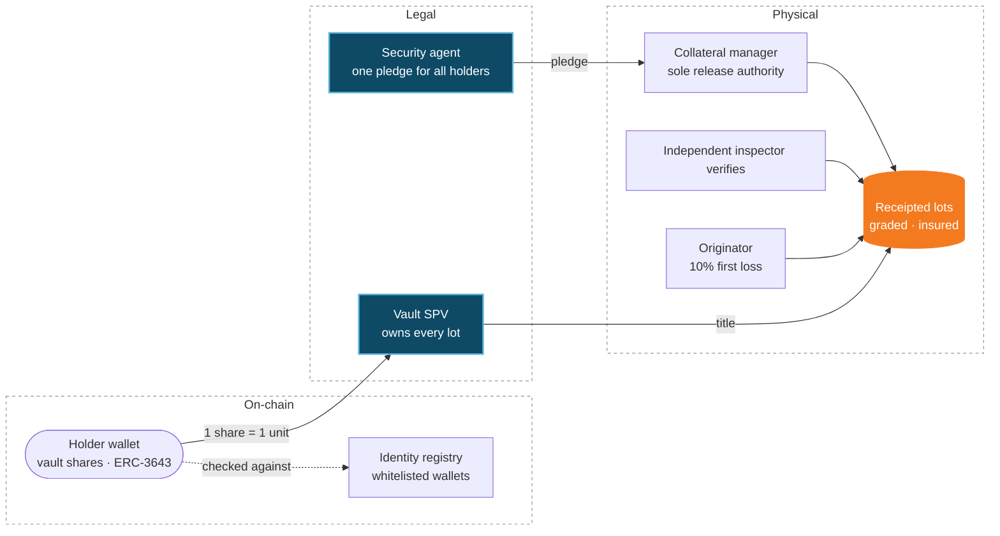
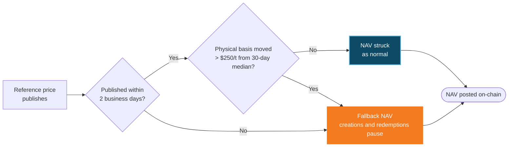

Every Cargo vault share is backed by one unit of a real-world asset that already exists, sits in a named warehouse or vault, and has been signed for by an independent collateral manager. Worked examples on this page are from the **Genesis Vault**: West African Grade 1 cocoa, priced off ICE London Cocoa, issued as cvCOCOA.

## What stands behind a share

Three layers: the shares on-chain, the legal title and pledge, and the physical goods under independent control.

<AccordionGroup>
  <Accordion title="Title" icon="file-contract">
    A bankruptcy-remote **Vault SPV** owns every receipted lot from the moment of receipt. It has no other business and no other creditors, and every contract carries non-petition and limited-recourse terms.
  </Accordion>
  <Accordion title="Pledge" icon="lock">
    As a backstop, the goods are pledged **with dispossession** to the collateral manager as third-party holder, and the pledge is registered. One pledge, one security agent, for all holders.
  </Accordion>
  <Accordion title="Custody" icon="warehouse">
    An independent collateral manager controls the warehouse or vault and releases goods only against payment.
  </Accordion>
  <Accordion title="Proof" icon="magnifying-glass">
    An independent inspector weighs and grades every lot (Vallis in the Genesis Vault). Lot IDs, weights and grades are public, and the weekly stock report is hashed on-chain.
  </Accordion>
  <Accordion title="First loss" icon="shield-halved">
    Originators keep **10% of every lot** as subordinated shares, released only when the lot is sold and reconciles. Senior cover at origination is 111%.
  </Accordion>
  <Accordion title="Insurance" icon="umbrella">
    All-risks stock insurance on every lot, paid by the originator until the goods are sold.
  </Accordion>
</AccordionGroup>

## The mint

<Steps>
  <Step title="Deliver">A lot of at least the vault's minimum size enters the warehouse (25 t in the Genesis Vault).</Step>
  <Step title="Receipt">The collateral manager weighs, grades and samples it and issues a receipt in the SPV's name (for cocoa: moisture, cut test and bean count; for gold: fineness and weight).</Step>
  <Step title="Mint 1:1">Shares are minted per unit: 90% senior, held for sale; 10% subordinated, held for the originator.</Step>
  <Step title="List">Lot ID, quantity, grade, receipt, originator and reserve price are published before the next batch window.</Step>
</Steps>

**The backing rule.** Supply can never exceed receipted units in custody, and no unit can count both as stock and as sale proceeds. The minting guard enforces this on-chain; the weekly stock report reconciles it.

**Legal opinions.** Counsel give opinions on title, the pledge and enforcement before a vault's first mint. Investors' counsel can review them in the data room.

## NAV: a published reference price, struck daily

Each vault's NAV starts from a published reference price for the asset, less the fixed costs of getting it to a buyer, in USD:

<Card title="NAV per share = (reference price − levies − delivery costs) ÷ FX" icon="calculator">
  The reference is an exchange settlement price (ICE for cocoa, coffee and sugar) or a benchmark such as LBMA for gold.
</Card>

### In the Genesis Vault: ICE London Cocoa

NAV follows the **ICE London Cocoa** settlement price for West African Grade 1 beans, less delivery costs, converted from GBP to USD. At 9 Oct 2026, NAV was **$5.277** per share (per kg).

<Frame caption="Genesis Vault, prices of 9 Oct 2026. NAV is restruck every day.">
  
  
</Frame>

The trade it captures, per kilogram: farmgate **$4.522** → receipted cost **$4.793** → NAV **$5.277**. The **10.1% spread** is the margin that normally goes to whoever exports.

**iNAV.** Between daily fixes, iNAV moves with ICE London Cocoa in real time: every minute by API and WebSocket, every 15 minutes on-chain during market hours. Creations and redemptions always strike at NAV.

## Price guards

Every vault's NAV has the same four guards. Genesis Vault values shown:

| Guard | Rule (Genesis Vault values) |
| :-- | :-- |
| Basis check | If the physical differential to the reference moves more than $250/t from its 30-day median, NAV uses the median differential and creations and redemptions pause for that batch |
| Reference outage | No reference price for two business days: same fallback |
| Realised-price reset | Vault sales averaging more than $150/t below NAV over 30 days re-base the cost line at once |
| Lending oracle | Lending markets read the lower of reference NAV and hedge-market-implied NAV |

Each new vault publishes its own thresholds in its term sheet.

## Redemption and exit

| Route | Who | Price | Timing |
| :-- | :-- | :-- | :-- |
| Redemption | Holders above the vault minimum (1,000 shares in the Genesis Vault) | NAV − 0.10% | Request until 24 h before a batch; paid within 12 days in the Genesis Vault |
| Liquidity Bridge | Any holder | NAV − 1.0% | Instant, up to published capacity ($250k at Genesis launch) |
| Physical delivery | Above a set size (10,000 shares, 10 t, in the Genesis Vault) | At cost | Ex-warehouse, to your nominated buyer or exporter |
| Creation | Authorised participants | NAV + 0.10% | Any business day, in blocks, T+1 |

Anyone can create near NAV and redeem near NAV, so a premium or discount gets arbitraged away. What remains is the asset price, which market makers hedge on ICE London Cocoa (10,000 shares ≈ one 10 t lot), and credit, which the structure bounds.

<Info>
  **Credit floor, Genesis Vault.** If the cocoa ever had to be sold locally at the exporter bid ($4.70–$4.87 per kg) instead of at NAV, a senior share would still be covered at **98.9%–102.5%** of NAV, thanks to the 10% subordination.
</Info>
