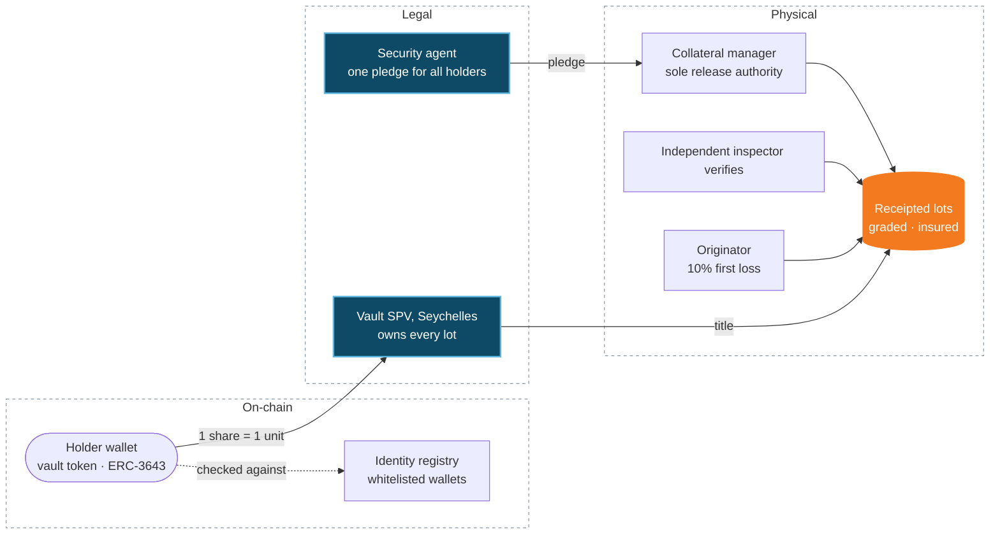
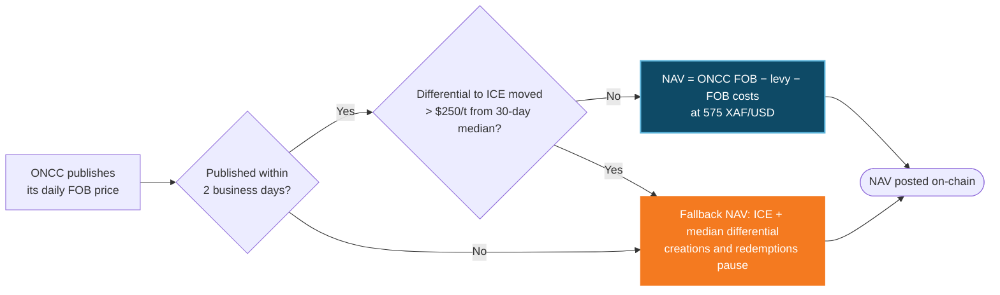

Every Cargo vault share is backed by one unit of a real-world asset that already exists, sits in a named warehouse or vault and has been signed for by an independent collateral manager. The unit depends on the asset: a kilogram of cocoa, a tonne of sugar, an ounce of gold. This page explains how that link is built and how the price is set. Figures and names in the examples are from the **Genesis Vault**: export-grade Cameroon cocoa in Douala, issued as cvCOCOA.

## What stands behind a share

Three layers stand behind every share: the token on-chain, the legal title and pledge, and the physical goods under independent control.

<AccordionGroup>
  <Accordion title="Title" icon="file-contract">
    A bankruptcy-remote Seychelles **Vault SPV** owns every receipted lot under a supply agreement that takes effect on receipt. It has no other business and no other creditors, and every contract carries non-petition and limited-recourse terms.
  </Accordion>
  <Accordion title="Pledge" icon="lock">
    As a backstop, the delivering company pledges the goods to the collateral manager as agreed third-party holder, under the secured-transactions law where the goods are stored, and registers the pledge. One pledge, one security agent, for all holders. In the Genesis Vault, the pledge is **with dispossession** under the OHADA Uniform Act on secured transactions, registered at the RCCM.
  </Accordion>
  <Accordion title="Custody" icon="warehouse">
    An independent collateral manager controls the warehouse or vault and releases goods only against payment. In the Genesis Vault, that is the bay at **AGL Bonabéri, Douala**.
  </Accordion>
  <Accordion title="Proof" icon="magnifying-glass">
    An independent inspector checks, weighs and grades every lot (Vallis in the Genesis Vault). Lot IDs, weights and grades are public, and the collateral manager's weekly stock report is hashed on-chain.
  </Accordion>
  <Accordion title="First loss" icon="shield-halved">
    Originators keep **10% of every lot** as subordinated shares, released only when the lot is sold and reconciles. Senior cover at origination is 111% of senior shares, in units of the asset.
  </Accordion>
  <Accordion title="Insurance" icon="umbrella">
    All-risks stock insurance on every lot, paid by the originator until the goods are sold.
  </Accordion>
</AccordionGroup>

## The mint

<Steps>
  <Step title="Deliver">A lot of at least the vault's minimum size enters the warehouse (25 t in the Genesis Vault).</Step>
  <Step title="Receipt">The collateral manager weighs, grades and samples it and issues a receipt in the SPV's name, with the quality checks the asset's trade standard requires (for cocoa: moisture, cut test and bean count; for gold: fineness and weight).</Step>
  <Step title="Mint 1:1">Shares are minted per unit: 90% senior, held for sale; 10% subordinated, held for the originator.</Step>
  <Step title="List">The lot ID, quantity, grade, receipt, originator and reserve price are published before the next batch window opens.</Step>
</Steps>

**The backing rule.** Supply can never exceed receipted units in custody, and the same unit can never count both as physical stock and as sale proceeds. The minting guard enforces this on-chain, and the weekly stock report reconciles it.

**Legal opinions.** Counsel in Seychelles and in the country where the goods are stored give their opinions on title, the pledge and enforcement before a vault's first mint (for the Genesis Vault, Seychelles and Cameroon). Investors' counsel can review them in the data room.

## NAV: a published reference price, struck daily

Each vault's NAV starts from a published reference price for the asset at the point where it is sold, less the fixed costs of getting it there, converted to USD:

**NAV per share = (reference price − statutory levies − delivery costs) ÷ FX**

The reference is chosen per vault: a national board's published export price, an exchange settlement price (for example ICE for cocoa, coffee or sugar) or a benchmark such as the LBMA price for gold. Every vault also has a liquid market to cross-check and hedge against.

### In the Genesis Vault: export parity off ONCC

**NAV per share = (ONCC FOB reference − export levy − FOB costs) ÷ FX**

| Input | At 9 Oct 2026 | Source and rule |
| :-- | --: | :-- |
| ONCC FOB reference, cocoa | 3,259 FCFA/kg | ONCC daily published price |
| Export levy | −125 FCFA/kg | Statutory; changes only with the law |
| FOB costs (port, phyto, handling, insurance) | −100 FCFA/kg | Fixed per quarter, re-based on invoices |
| FX | 575 XAF per USD | Fixed XAF/EUR peg (655.957) ÷ EUR/USD reference rate |
| **NAV** | **3,034 FCFA/kg = $5.277** | Struck after ONCC publishes; posted on-chain |

The trade it captures, per kilogram: farmgate **2,600 FCFA** → receipted cost in Douala **2,756 FCFA ($4.793)** → NAV **3,034 FCFA ($5.277)**. The **10.1% delta** is the margin that normally goes to whoever exports.

<Frame caption="Genesis Vault, ONCC prices of 9 Oct 2026. NAV is restruck every day.">
  
  
</Frame>

**iNAV.** Between daily fixes, an indicative NAV moves NAV with the asset's reference market. In the Genesis Vault, that is ICE London cocoa (second position), converted through GBP, EUR and the peg. iNAV is published every minute by API and WebSocket and every 15 minutes on-chain during market hours. Creations and redemptions always strike at NAV, not iNAV.

## Price guards

Every vault's NAV is protected by the same set of guards: a check against the hedge market, a fallback if the reference stops publishing, a reset if realised sales run below NAV, and a conservative oracle for lending. This is how they work in the Genesis Vault, where the ONCC price is checked against ICE:

| Guard | Rule (Genesis Vault values) |
| :-- | :-- |
| Differential check | If the ONCC-implied differential to ICE moves more than $250/t from its 30-day median, NAV falls back to ICE plus the median differential, and creations and redemptions pause for that batch |
| Reference outage | If ONCC does not publish for two business days, the same fallback applies |
| Realised-price reset | If the vault's own sales average more than $150/t below NAV over 30 days, the cost line is re-based at once |
| Lending oracle | Any lending market reads the lower of reference NAV and hedge-market-implied NAV |

Each new vault publishes its own thresholds in its term sheet.

## Redemption and exit

| Route | Who | Price | Timing |
| :-- | :-- | :-- | :-- |
| Redemption | Any holder above the vault minimum (1,000 shares in the Genesis Vault) | NAV − 0.10% | Request until 24 h before a batch; struck at that batch; paid within the vault's settlement period (12 days of the strike in the Genesis Vault) |
| Liquidity Bridge | Any holder | NAV − 1.0% | Instant, up to published capacity ($250k at Genesis Vault launch) |
| Physical delivery | Above a set size (10,000 shares, 10 t, in the Genesis Vault) | At cost | Ex-warehouse, to your nominated buyer or exporter (Genesis Vault: ex-warehouse Douala, to your ONCC-registered exporter) |
| Creation | Authorised participants | NAV + 0.10% | Any business day, in blocks, T+1 |

Because anyone can create near NAV and redeem near NAV, a premium or discount on the secondary market can be arbitraged away. What remains is the asset's price, which market makers hedge on its reference market (in the Genesis Vault, 10,000 shares move like one 10 t ICE London cocoa lot), and credit, which the structure above bounds.

<Info>
  **Credit floor, Genesis Vault.** If export ever failed and the cocoa had to be sold in Douala at ONCC's exporter bid (2,700–2,800 FCFA/kg), a senior share would still be covered at **98.9%–102.5%** of NAV, thanks to the 10% subordination.
</Info>
