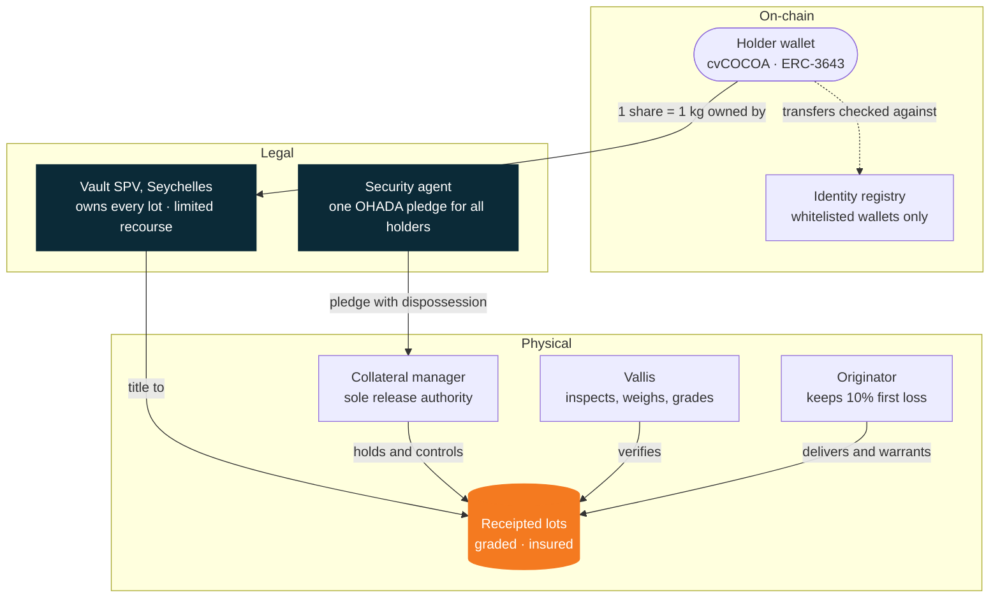
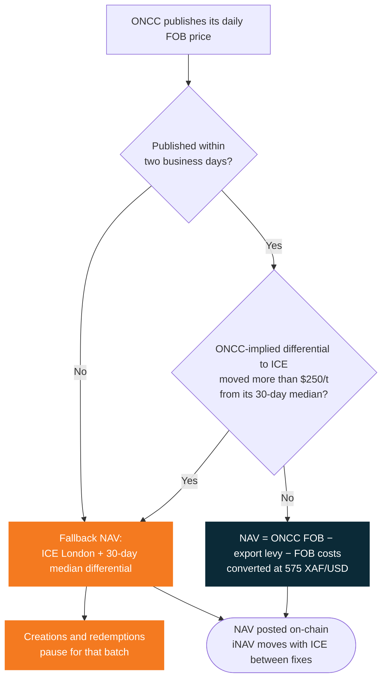

Every cvCOCOA share is backed by one kilogram of cocoa that already exists, sits in a named bay and has been signed for by an independent collateral manager. This page explains how that link is built and how the price is set.

## What stands behind a share

Three layers stand behind every share: the token on-chain, the legal title and pledge, and the physical cocoa under independent control.

<AccordionGroup>
  <Accordion title="Title" icon="file-contract">
    A bankruptcy-remote Seychelles **Vault SPV** owns every receipted lot under a supply agreement that takes effect on receipt. It has no other business and no other creditors, and every contract carries non-petition and limited-recourse terms.
  </Accordion>
  <Accordion title="Pledge" icon="lock">
    As a backstop, the delivering company pledges the goods **with dispossession** to the collateral manager as agreed third-party holder, under the OHADA Uniform Act on secured transactions, registered at the RCCM. One pledge, one security agent, for all holders.
  </Accordion>
  <Accordion title="Custody" icon="warehouse">
    An independent collateral manager controls the bay at **AGL Bonabéri, Douala**, and releases goods only against payment.
  </Accordion>
  <Accordion title="Proof" icon="magnifying-glass">
    Vallis inspects, weighs and grades every lot. Lot IDs, weights and grades are public, and the collateral manager's weekly stock report is hashed on-chain.
  </Accordion>
  <Accordion title="First loss" icon="shield-halved">
    Originators keep **10% of every lot** as subordinated shares, released only when the lot exports and reconciles. Senior cover at origination is 111% of senior shares, in kilograms.
  </Accordion>
  <Accordion title="Insurance" icon="umbrella">
    All-risks stock insurance on every lot, paid by the originator until export.
  </Accordion>
</AccordionGroup>

## The mint

<Steps>
  <Step title="Deliver">A lot of 25 t or more enters the bay.</Step>
  <Step title="Receipt">The collateral manager weighs, grades and samples it and issues a receipt in the SPV's name. Moisture, cut test and bean count are recorded.</Step>
  <Step title="Mint 1:1">Shares are minted per kilogram: 90% senior, held for sale; 10% subordinated, held for the originator.</Step>
  <Step title="List">The lot ID, tonnage, grade, receipt, originator and reserve price are published before the next batch window opens.</Step>
</Steps>

**The backing rule.** Supply can never exceed receipted kilograms in the bay, and the same kilogram can never count both as physical stock and as sale proceeds. The minting guard enforces this on-chain, and the weekly stock report reconciles it.

**Legal opinions.** Counsel in Seychelles and in Cameroon give their opinions on title, the pledge and enforcement before the first mint. Investors' counsel can review them in the data room.

## NAV: export parity, struck daily

**NAV per share = (ONCC FOB reference − export levy − FOB costs) ÷ FX**

| Input | At 9 Oct 2026 | Source and rule |
| :-- | --: | :-- |
| ONCC FOB reference, cocoa | 3,259 FCFA/kg | ONCC daily published price |
| Export levy | −125 FCFA/kg | Statutory; changes only with the law |
| FOB costs (port, phyto, handling, insurance) | −100 FCFA/kg | Fixed per quarter, re-based on invoices |
| FX | 575 XAF per USD | Fixed XAF/EUR peg (655.957) ÷ EUR/USD reference rate |
| **NAV** | **3,034 FCFA/kg = $5.277** | Struck after ONCC publishes; posted on-chain |

The trade it captures, per kilogram: farmgate **2,600 FCFA** → receipted cost in Douala **2,756 FCFA ($4.793)** → NAV **3,034 FCFA ($5.277)**. The **10.1% delta** is the margin that normally goes to whoever exports.

<Frame caption="ONCC prices of 9 Oct 2026. NAV is restruck every day.">
  
  
</Frame>

**iNAV.** Between daily fixes, an indicative NAV moves NAV with ICE London cocoa (second position), converted through GBP, EUR and the peg. It is published every minute by API and WebSocket and every 15 minutes on-chain during ICE hours. Creations and redemptions always strike at NAV, not iNAV.

## Price guards

How each day's NAV is set, and what happens when the ONCC price and ICE disagree:

| Guard | Rule |
| :-- | :-- |
| Differential check | If the ONCC-implied differential to ICE moves more than $250/t from its 30-day median, NAV falls back to ICE plus the median differential, and creations and redemptions pause for that batch |
| ONCC outage | If ONCC does not publish for two business days, the same fallback applies |
| Realised-price reset | If the vault's own export sales average more than $150/t below NAV over 30 days, the FOB-cost line is re-based at once |
| Lending oracle | Any lending market reads the lower of ONCC NAV and ICE-implied NAV |

## Redemption and exit

| Route | Who | Price | Timing |
| :-- | :-- | :-- | :-- |
| Redemption | Any holder from 1,000 shares | NAV − 0.10% | Request until 24 h before a batch; struck at that batch; paid within 12 days of the strike |
| Liquidity Bridge | Any holder | NAV − 1.0% | Instant, up to published capacity ($250k at launch) |
| Physical delivery | From 10,000 shares (10 t) | At cost | Ex-warehouse Douala, to your ONCC-registered exporter |
| Creation | Authorised participants | NAV + 0.10% | Any business day, blocks of 1,000 shares, T+1 |

Because anyone can create near NAV and redeem near NAV, a premium or discount on the secondary market can be arbitraged away. What remains is cocoa price, which market makers hedge on ICE London (10,000 shares move like one 10 t lot), and credit, which the structure above bounds.

<Info>
  **Credit floor.** If export ever failed and the goods had to be sold in Douala at ONCC's exporter bid (2,700–2,800 FCFA/kg), a senior share would still be covered at **98.9%–102.5%** of NAV, thanks to the 10% subordination.
</Info>
