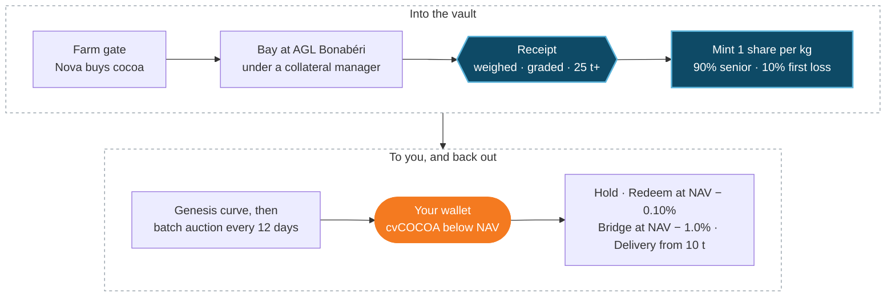

**Real world. Real assets. Real yield.**

Cargo Finance brings real-world assets and emerging-market trade finance on-chain. We originate, allocate and curate commodity vaults. Our first programme, **Cargo Vault One**, holds exchange-grade soft commodities as receipted, pledged inventory at the port and turns them into a token that eligible investors can hold, trade, redeem or take delivery of.

## Cargo Vault One in one paragraph

Holders own **cvCOCOA** (Cargo Vault Cocoa). **One share is one kilogram** of export-grade Cameroon cocoa in a collateral-managed bay at AGL Bonabéri, Douala. A bankruptcy-remote Seychelles SPV owns every receipted lot. Each share is priced daily at **NAV**: the official ONCC export (FOB) reference price, less the export levy and FOB costs. New shares are sold below NAV, first through the **Genesis Auction** and then in a sealed **batch auction every 12 days**. You can redeem at NAV, sell instantly through the Liquidity Bridge, or take the cocoa from 10 tonnes.

<CardGroup cols={3}>
  <Card title="1 share = 1 kg" icon="weight-hanging">
    Receipted cocoa you can point to: lot ID, weight and grade are public.
  </Card>
  <Card title="$5.277 NAV" icon="chart-line">
    Export parity per share at ONCC prices of 9 Oct 2026, struck daily.
  </Card>
  <Card title="10.1% delta" icon="arrow-up-right-dots">
    Spread between receipted cost in Douala and export parity.
  </Card>
</CardGroup>

## Why it exists

Trade finance is short of money, not of trades. Africa's trade-finance gap was estimated at **at least $74bn in 2024** (AfDB). A bag of cocoa in a Douala warehouse is valuable, but a lender in Zurich, Dubai or Singapore struggles to verify it, take title to it, enforce a claim on it and sell it at a known price. Cargo makes the kilogram itself into collateral that travels: checked by an independent collateral manager, owned by a ring-fenced SPV, pledged under OHADA law, priced off a published reference and settled in USDC on a public chain.

## How it works

<Steps>
  <Step title="Originate">
    Nova Commodities Cameroon buys export-grade cocoa and delivers it into a bay under an independent collateral manager in Douala.
  </Step>
  <Step title="Receipt and mint">
    The collateral manager weighs, grades and signs for each lot of 25 t or more. Shares are minted 1:1 per kilogram. No receipt, no mint.
  </Step>
  <Step title="Sell below NAV">
    The SPV sells new shares in the Genesis Auction and then in batch auctions every 12 days, at a clearing price below NAV.
  </Step>
  <Step title="Hold, rotate or exit">
    Holders keep the discount (Hold), recycle it every batch (Rotate), redeem at NAV, use the Liquidity Bridge, or take physical delivery.
  </Step>
</Steps>

The whole journey, from the farm gate to your wallet and back out:

<Warning>
  Cargo Vault One is offered only to eligible non-US professional or institutional investors who are not resident in a CEMAC country or in Seychelles. Nothing in these docs is an offer where it would be unlawful. Figures are illustrations at stated prices, not forecasts. Capital is at risk.
</Warning>

## Reading the docs

<CardGroup cols={2}>
  <Card title="Get started" icon="rocket" href="/quickstart">
    Eligibility, KYC, wallet whitelisting and how to take part.
  </Card>
  <Card title="How the vault works" icon="vault" href="/ecosystem/rwa-vault-mechanism">
    Title, pledge, proof of reserve, NAV and redemption.
  </Card>
  <Card title="cvCOCOA" icon="layer-group" href="/products/vaults">
    The token, the vault lines and supported networks.
  </Card>
  <Card title="Risk checklist" icon="shield" href="/safety/risk-checklist">
    What can go wrong, and what absorbs each risk.
  </Card>
</CardGroup>
