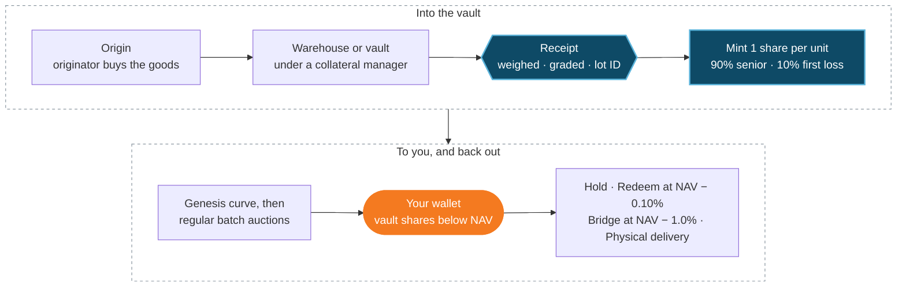

**Real world. Real assets. Real yield.**

Cargo Finance brings real-world assets and emerging-market trade finance on-chain. We originate, allocate and curate asset vaults: soft commodities such as cocoa, coffee and sugar, precious metals such as gold, and other goods that can be receipted, stored under independent control and priced off a published reference. Each vault holds the physical goods as receipted, pledged inventory and turns them into a token that eligible investors can hold, trade, redeem or take delivery of.

## How a Cargo vault works, in one paragraph

Each vault holds one asset in one location and issues one token. **One share is one unit** of the physical asset (a kilogram, a tonne or an ounce, depending on the vault) sitting under an independent collateral manager. A bankruptcy-remote Seychelles SPV owns every receipted lot. Each share is priced daily at **NAV**, set from a published reference price for the asset less the costs of getting it to market. New shares are sold below NAV, first through a **Genesis Auction** and then in sealed **batch auctions** at fixed intervals. You can redeem at NAV, sell instantly through the Liquidity Bridge, or take delivery of the goods.

<CardGroup cols={3}>
  <Card title="1 share = 1 unit" icon="weight-hanging">
    Receipted goods you can point to: lot ID, weight and grade are public for every lot.
  </Card>
  <Card title="Priced daily at NAV" icon="chart-line">
    NAV comes from a published reference price for the asset, struck every day and posted on-chain.
  </Card>
  <Card title="Sold below NAV" icon="arrow-up-right-dots">
    New shares are only ever sold below NAV, so buyers share in the spread between origin and market.
  </Card>
</CardGroup>

## The Genesis Vault: Cameroon cocoa

Our first programme, **Cargo Vault One**, opens with the **Genesis Vault**. It issues **cvCOCOA** (Cargo Vault Cocoa): one share is one kilogram of export-grade Cameroon cocoa in a collateral-managed bay at AGL Bonabéri, Douala, priced daily at export parity off the ONCC reference price. At ONCC prices of 9 Oct 2026, NAV was **$5.277** per share, with a **10.1%** spread between the receipted cost in Douala and export parity. See [Real-World Assets](/products/real-world-assets#the-genesis-vault-cameroon-cocoa) for the full details.

## Why it exists

Trade finance is short of money, not of trades. Africa's trade-finance gap alone was estimated at **at least $74bn in 2024** (AfDB). Goods in a warehouse at origin are valuable, but a lender in Zurich, Dubai or Singapore struggles to verify them, take title to them, enforce a claim on them and sell them at a known price. Cargo makes the physical unit itself into collateral that travels: checked by an independent collateral manager, owned by a ring-fenced SPV, pledged under local law, priced off a published reference and settled in USDC on a public chain.

## How it works

<Steps>
  <Step title="Originate">
    An approved originator buys the goods and delivers them into a warehouse or vault under an independent collateral manager.
  </Step>
  <Step title="Receipt and mint">
    The collateral manager weighs, grades and signs for each lot. Shares are minted 1:1 per unit. No receipt, no mint.
  </Step>
  <Step title="Sell below NAV">
    The SPV sells new shares in the Genesis Auction and then in regular batch auctions, at a clearing price below NAV.
  </Step>
  <Step title="Hold, rotate or exit">
    Holders keep the discount (Hold), recycle it every batch (Rotate), redeem at NAV, use the Liquidity Bridge, or take physical delivery.
  </Step>
</Steps>

The whole journey, from origin to your wallet and back out:

<Warning>
  Cargo vaults are offered only to eligible non-US professional or institutional investors who are not resident in Seychelles or in any jurisdiction a vault's term sheet excludes (for the Genesis Vault, the CEMAC countries). Nothing in these docs is an offer where it would be unlawful. Figures are illustrations at stated prices, not forecasts. Capital is at risk.
</Warning>

## Reading the docs

<CardGroup cols={2}>
  <Card title="Get started" icon="rocket" href="/quickstart">
    Eligibility, KYC, wallet whitelisting and how to take part.
  </Card>
  <Card title="How a vault works" icon="vault" href="/ecosystem/rwa-vault-mechanism">
    Title, pledge, proof of reserve, NAV and redemption.
  </Card>
  <Card title="Vaults and tokens" icon="layer-group" href="/products/vaults">
    The vault tokens, the vault lines and supported networks.
  </Card>
  <Card title="Risk checklist" icon="shield" href="/safety/risk-checklist">
    What can go wrong, and what absorbs each risk.
  </Card>
</CardGroup>
