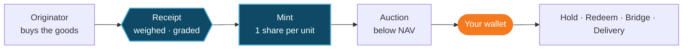

**Real world. Real assets. Real yield.**

Cargo Finance turns physical goods into on-chain vaults. Each vault holds one asset (cocoa, coffee, sugar, gold or anything else that passes our [eight tests](/products/real-world-assets#eight-tests-for-any-commodity)) and issues vault shares. **One share is one unit of the asset**, under independent custody, priced daily at NAV, and sold to you below it.

<CardGroup cols={3}>
  <Card title="1 share = 1 unit" icon="weight-hanging">
    A kilogram, a tonne or an ounce you can point to. Lot ID, weight and grade are public.
  </Card>
  <Card title="Priced daily at NAV" icon="chart-line">
    Set from a published exchange price and posted on-chain every day.
  </Card>
  <Card title="Bought below NAV" icon="arrow-up-right-dots">
    New shares only ever sell below NAV. The discount is your return and your cushion.
  </Card>
</CardGroup>

## The Genesis Vault

The first vault holds **West African Grade 1 cocoa**, priced off **ICE London Cocoa**, and issues **cvCOCOA**: one share, one kilogram.

<CardGroup cols={4}>
  <Card title="$5.277" icon="tag">
    NAV per share, 9 Oct 2026
  </Card>
  <Card title="10.1%" icon="percent">
    Spread from receipted cost to NAV
  </Card>
  <Card title="9.2% → 3.0%" icon="arrow-trend-down">
    Discount to NAV on the Genesis curve
  </Card>
  <Card title="1,020 t" icon="ship">
    Bought, shipped and sold in the first cycle
  </Card>
</CardGroup>

<Card title="Explore the Genesis Vault" icon="arrow-right" href="/products/real-world-assets#the-genesis-vault" horizontal>
  The asset, the price reference, the numbers and the legal structure.
</Card>

## Why it exists

Trade finance is short of money, not of trades: the global gap is about **$2.5tn** (ADB, 2023). Goods in a warehouse are valuable, but a distant lender struggles to verify them, own them, enforce a claim and sell them at a known price. Cargo makes the physical unit itself into collateral that travels: checked, owned, pledged, priced and settled in USDC.

## How it works

<Steps>
  <Step title="Originate" icon="seedling">
    An approved originator buys the goods and delivers them to a warehouse under an independent collateral manager.
  </Step>
  <Step title="Receipt and mint" icon="stamp">
    Each lot is weighed, graded and signed for. Shares are minted 1:1. No receipt, no mint.
  </Step>
  <Step title="Sell below NAV" icon="gavel">
    The vault sells new shares in a Genesis Auction, then in regular sealed batch auctions.
  </Step>
  <Step title="Hold, rotate or exit" icon="arrows-rotate">
    Keep the discount, recycle it every batch, redeem at NAV, exit instantly through the bridge, or take delivery.
  </Step>
</Steps>

## Start here

<CardGroup cols={2}>
  <Card title="Get started" icon="rocket" href="/quickstart">
    Eligibility, KYC, wallet whitelisting and your first bid.
  </Card>
  <Card title="How a vault works" icon="vault" href="/ecosystem/rwa-vault-mechanism">
    Title, pledge, proof of reserve, NAV and redemption.
  </Card>
  <Card title="Vaults and shares" icon="layer-group" href="/products/vaults">
    The vault shares, the vault lines and supported networks.
  </Card>
  <Card title="Risk checklist" icon="shield" href="/safety/risk-checklist">
    What can go wrong, and what absorbs each risk.
  </Card>
</CardGroup>

<Warning>
  Cargo vaults are offered only to eligible non-US professional or institutional investors who are not resident in any jurisdiction a vault's term sheet excludes (for the Genesis Vault, the CEMAC region). Nothing here is an offer where it would be unlawful. Figures are illustrations at stated prices, not forecasts. Capital is at risk.
</Warning>
