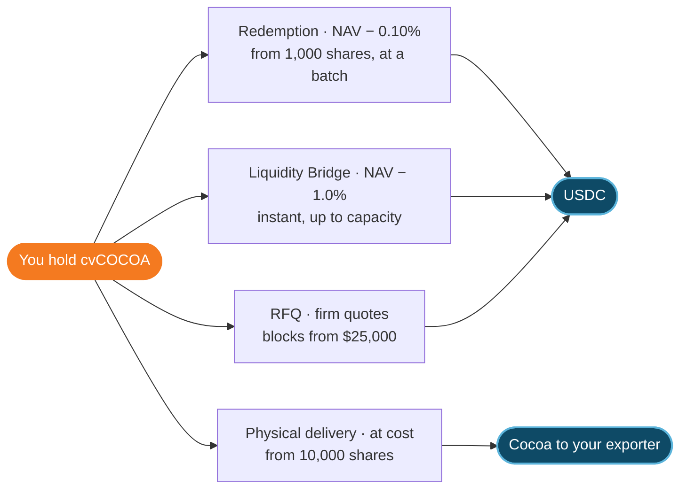

New shares are sold only by the Vault SPV, below NAV. You hold them in your own whitelisted wallet. There are four ways out.

## Buying

### Genesis Auction (Cycle 1)

A bonding curve that stops below NAV. The price rises with the USDC raised, so earlier money buys at a deeper discount.

**Price per share P(R) = 4.793 + (5.118 − 4.793) × R ÷ 1,500,000**, where R is USDC raised so far.

<Frame caption="Earlier money buys at a deeper discount. Every seat is below NAV.">
  
  
</Frame>

| | |
| :-- | :-- |
| First seat | $4.793, 9.2% below NAV |
| Last seat | $5.118, 3.0% below NAV |
| Bands | A: 8.1% below NAV · B: 6.1% · C: 4.0% |
| Minimum | $500,000 raised, or every dollar is refunded |
| Cap | $1,500,000: 302.8 t of cocoa at an average $4.954 (6.1% below NAV) |
| Ceiling | No buyer pays above 97% of NAV |
| Fees | None on the curve |
| Fill order | By time; the priority window fills first |
| Window | A priority window, then a public window, then settlement. Rescheduled from 14–23 Oct 2026; new dates to be announced |

Price along the curve, against the NAV of 9 Oct 2026 ($5.277):

| Raised before you | Price per share | Below NAV |
| :-- | --: | --: |
| $0 (first seat) | $4.793 | 9.2% |
| $500k | $4.901 | 7.1% |
| $1M | $5.010 | 5.1% |
| $1.5M (last seat) | $5.118 | 3.0% |

### Batch auctions, every 12 days

<Steps>
  <Step title="Lots are published">
    Lot ID, tonnage, grade, warehouse, receipt, originator and reserve are published before the window opens.
  </Step>
  <Step title="Place a sealed bid">
    Price per share and quantity, minimum $5,000. Bids can be edited until clearing.
  </Step>
  <Step title="Clearing">
    Every 12 days at 12:00 UTC, starting after Genesis settlement (weekends and ICE holidays roll to the next ICE trading day). One uniform price, the lowest winning bid, pro rata at the margin.
  </Step>
  <Step title="Settlement">
    Atomic and on-chain: USDC against shares. 0.25% fee per side; panel market makers bid fee-free. The clearing price, discount to NAV, volume, bid-to-cover and lot IDs go on the public tape.
  </Step>
</Steps>

## Exiting

| Route | Who | Price | Timing |
| :-- | :-- | :-- | :-- |
| **Redemption** | Any holder from 1,000 shares | NAV − 0.10% | Request until 24 h before a batch; struck at that batch; paid within 12 days |
| **Liquidity Bridge** | Any holder | NAV − 1.0% | Instant, up to published capacity |
| **RFQ** | Any holder | Firm quotes from panel market makers | From Genesis settlement; blocks from $25,000; settled atomically |
| **Physical delivery** | From 10,000 shares | At cost | Ex-warehouse Douala, to your ONCC-registered exporter |

<Warning>
  The first redemptions strike at **Batch 4**. If redemption requests exceed bridge capacity for two batches, capacity is raised and redemptions may be filled pro rata. There is no guarantee of a bid on RFQ.
</Warning>
