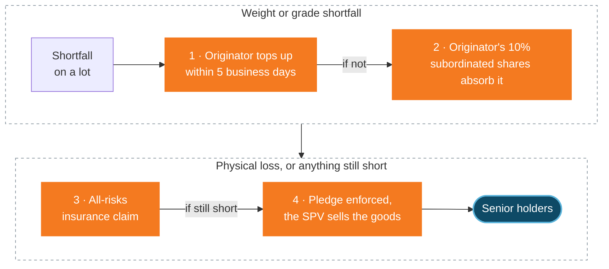

The goods behind every share are insured as physical stock, in every vault. Smart-contract risk is not insured.

## What is covered

| Cover | Scope | Paid by |
| :-- | :-- | :-- |
| All-risks stock insurance | Physical loss of or damage to receipted lots in storage | Originator, at cost, until the goods are sold |
| Transit cover | Goods moving from storage to the buyer | Within delivery costs, deducted in NAV (in the Genesis Vault, from the bay to the vessel, within FOB costs) |

The insurer and policy terms for each vault are shared with investors on signing and in the data room.

## What is not covered

- Smart-contract exploits, key loss or chain failures.
- Falls in the price of the underlying asset.
- Losses from legal or regulatory change.

## Loss absorption, in order

<Steps>
  <Step title="Originator top-up">A weight or grade shortfall is topped up by the originator within five business days.</Step>
  <Step title="Subordinated shares">If not, it is met from the originator's 10% subordinated shares (first loss).</Step>
  <Step title="Insurance">Physical loss or damage is claimed under the all-risks policy.</Step>
  <Step title="Enforcement">The security agent enforces the pledge (an OHADA pledge in the Genesis Vault), and the SPV sells the goods.</Step>
</Steps>

## How to verify cover

- Ask for the policy summary and certificate in the data room.
- Check the lot's receipt in the lot registry: every receipted lot must be insured.
- Policies are time-bound; check the cover period is current.

<Warning>
  Insurance does not cover every loss. Never assume full protection.
</Warning>
